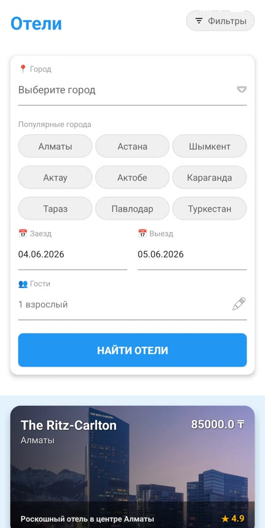
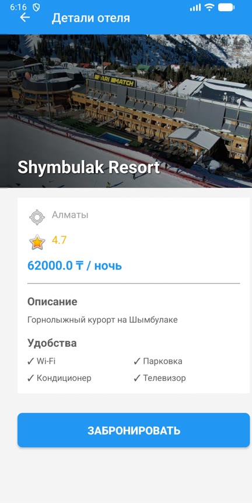
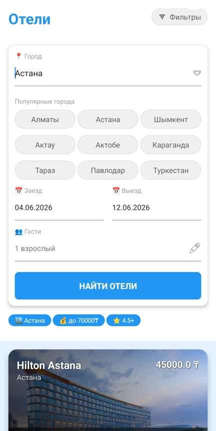

# Qonak

**Hotel and restaurant booking app for Kazakhstan** · Android · Java

Qonak (*қонақ*, "guest" in Kazakh) puts hotels and restaurants in one app. You can search venues by city, filter them, see them on a map and book a room or a table in a few taps.

Final project of the Android Development course at **Samsung Campus**.

<p>
  
  
  
</p>

<sub>Screenshots from v1.0.</sub>

## Problem

Travellers in Kazakhstan use 2–3 different apps to plan a trip: one to book a hotel, another to find a restaurant, and Instagram or a phone call to reserve a table. Qonak brings these steps into one local service.

## Features

- **Hotels:** search by city, check-in and check-out dates, number of guests.
- **Restaurants:** search by city and cuisine (11 cuisines).
- **Filters:** price range, minimum rating, sorting by price or rating (bottom sheet).
- **Map:** every venue has its own marker (restaurants are coloured by cuisine). Tap the label to open the venue. Shows your location if you allow it.
- **Booking:** date and time pickers, input checks and a live total. Past dates can't be selected.
- **My bookings:** list of bookings, long-press to cancel.
- **Profile:** booking stats and a button to clear all data.
- **Offline-first:** all data is stored locally in SQLite (Room).

## Tech stack

| Layer | Technology |
| --- | --- |
| Language | Java 11 |
| UI | XML layouts, Material Components, RecyclerView, CardView, BottomSheetDialog |
| Navigation | Jetpack Navigation Component, BottomNavigationView, single-activity + detail activities |
| Data | Room (SQLite): 3 entities, DAOs, filtering and sorting in SQL |
| Maps | Google Maps SDK, Play Services Location, runtime permissions (Activity Result API) |
| Concurrency | Shared single-thread executor for the database, lifecycle-safe UI callbacks |
| Tests | JUnit 4 (formatting, dates and Russian plural rules) |

## Project structure

```
app/src/main/java/com/qonak/app
├── MainActivity.java          # Bottom navigation host
├── hotels/                    # List, filters, details, booking dialog
├── restaurants/               # List, cuisine chips, details, booking dialog
├── maps/                      # Google Map with venue markers
├── bookings/                  # User bookings
├── profile/                   # Stats and data reset
├── database/                  # Room database and DAOs
├── models/                    # Hotel, Restaurant, Booking entities
└── utils/                     # Executors, formatters, images, booking form, seed data
```

## Getting started

1. Clone the repo and open it in **Android Studio**.
2. Get a Google Maps API key ([guide](https://developers.google.com/maps/documentation/android-sdk/get-api-key)).
3. Add it to `local.properties` in the project root. This file is git-ignored, so the key never reaches the repository:
   ```properties
   MAPS_API_KEY=your_key_here
   ```
4. Run the `app` configuration on a device or emulator (Android 7.0+, API 24).

Unit tests: `./gradlew test`

## What changed in v1.1

- **Security:** moved the Maps API key out of `AndroidManifest.xml` into `local.properties`.
- **Bug fixes:**
  - Fixed a possible crash: the details screen updated an image from a background thread.
  - Fixed check-in/check-out validation, which compared dates as text, so 01.12 counted as earlier than 15.11.
  - The number of guests in a restaurant booking is now saved instead of being guessed from the price.
  - Fixed a race on first launch, when the list could open before the demo data was loaded.
  - Fixed crashes when leaving a screen before a database query finished.
- **Map:** each venue has its own coordinates instead of one shared marker per city. Venue details open from the marker's info window.
- **UX:** real icons in the bottom navigation, prices with thousands separators (85 000 ₸), correct Russian plurals ("3 ночи", "5 ночей"), date and time pickers in booking dialogs.
- **Code quality:** removed duplicated image mapping and executors, deleted bookings with a single SQL query, added unit tests.

## Roadmap

- User accounts (Firebase Auth)
- Real venue data from a backend API
- Kazakh and English localisation
- Dark theme

## Author

**Aiganym Orman** · [GitHub](https://github.com/coffeezv) · [LinkedIn](https://www.linkedin.com/in/aiganym-orman-754988364/)
